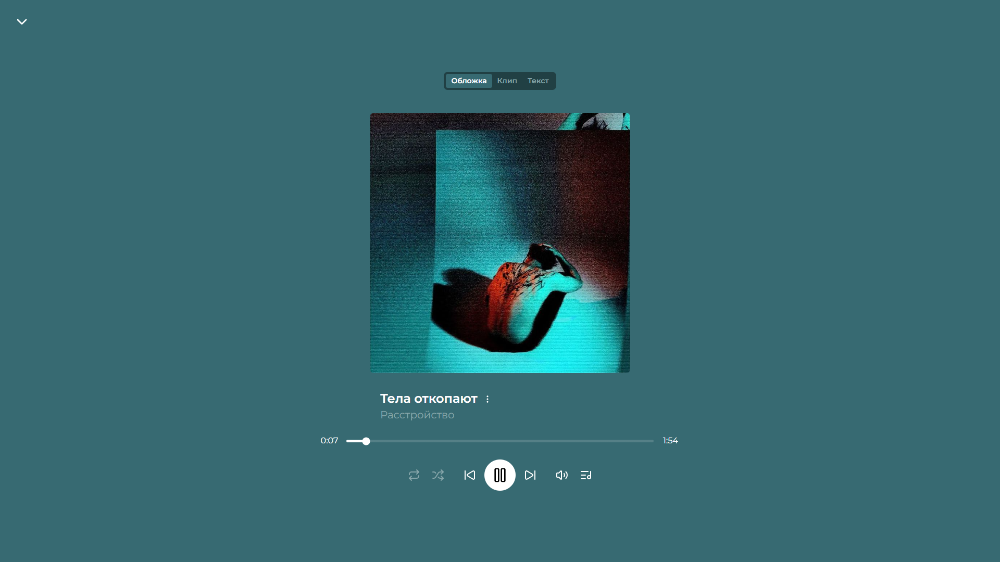
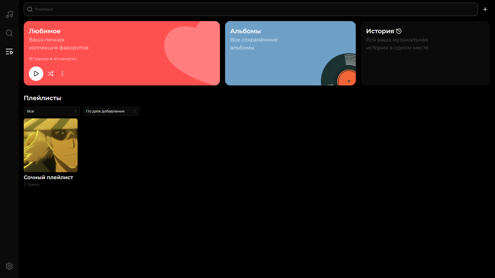
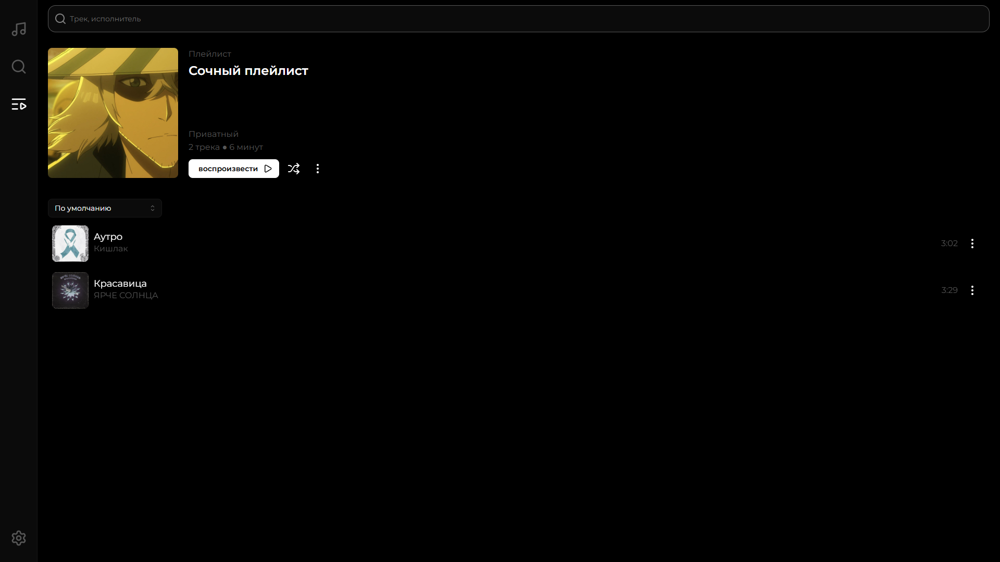
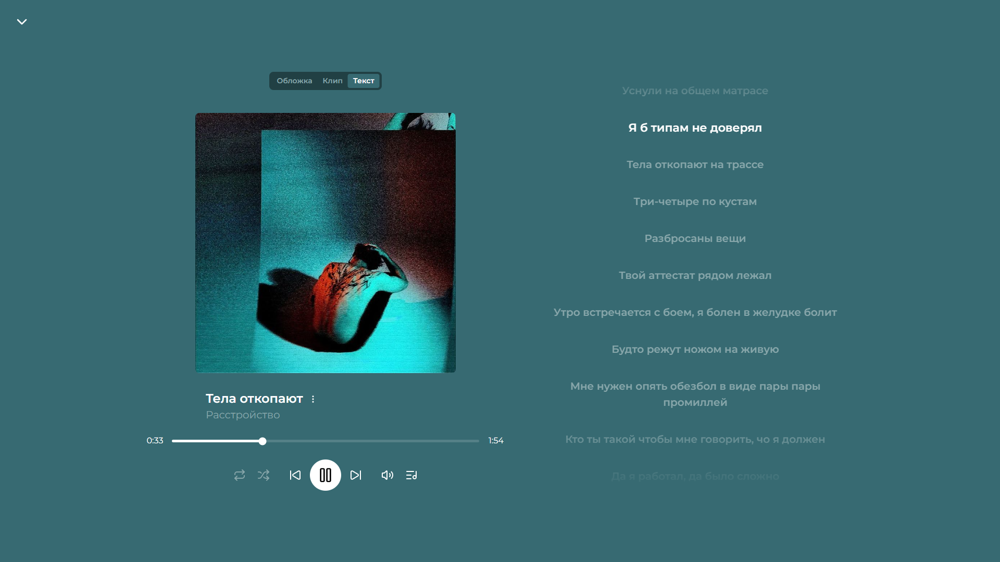
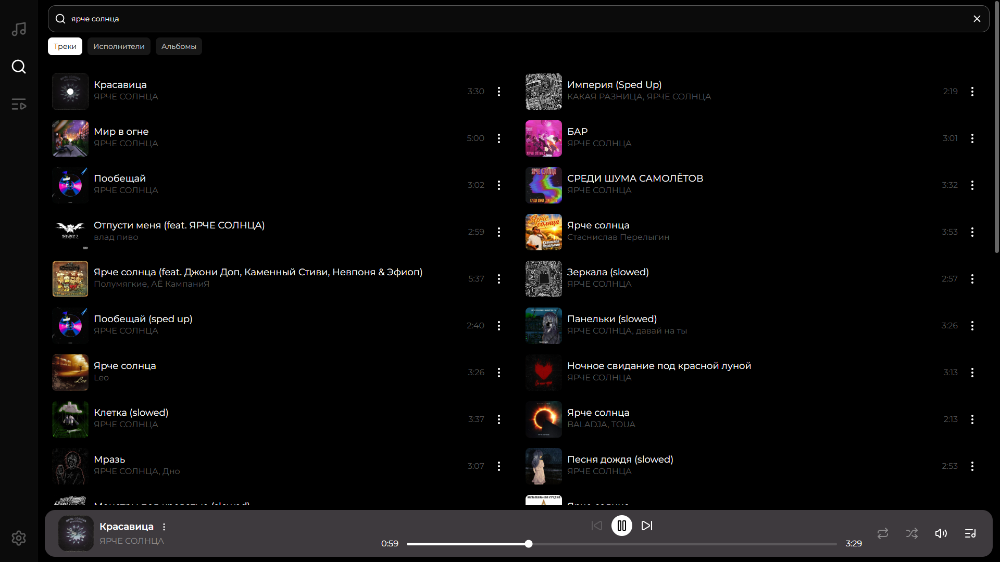

# Music — фронтенд

Личный музыкальный плеер с общей библиотекой: импорт треков и альбомов с YouTube, плейлисты, лайки, синхронизированные тексты песен, видеоряд, история прослушиваний и офлайн-режим как у PWA.

Это клиентская часть. Бэкенд (Express + SQLite + yt-dlp) лежит в отдельной папке и описан в своём README.

<p align="center">
  
</p>

---

## Скриншоты

| | |
|---|---|
|  |  |
| **Библиотека** — плейлисты, альбомы, лайки и история в одном месте | **Плейлист** — сортировка, перетаскивание треков, своя обложка |
|  |  |
| **Синхронизированный текст** — строки подсвечиваются в такт | **Поиск по YouTube** — импорт трека в один клик |

---

## Возможности

**Библиотека.** Треки, альбомы и артисты общие для всех пользователей, а плейлисты, лайки и история у каждого свои. Плейлисты бывают приватными и публичными, им можно менять обложку (с обрезкой прямо в браузере) и переставлять треки перетаскиванием.

**Импорт.** Поиск идёт по YouTube Music, трек или целый альбом импортируется одной кнопкой. Карточка появляется сразу со статусом «Загрузка…», а название, обложка и сам файл подтягиваются в фоне. Статус обновляется в реальном времени через SSE, страницу перезагружать не нужно.

**Плеер.** Очередь с перемешиванием и тремя режимами повтора (выключен, вся очередь, один трек). Есть полноэкранный режим, где фон подстраивается под цвета обложки, синхронизированный текст песни, видеоряд, если он есть у трека, и управление с экрана блокировки и наушников через Media Session API.

**История.** Прослушивания сгруппированы по датам и фильтруются по периоду.

**Офлайн.** Приложение устанавливается как PWA. Уже прослушанные треки и обложки остаются доступны без интернета, а списки берутся из кэша, сохранённого в IndexedDB. Если сети нет, приложение не выкидывает на экран входа, а продолжает работать с тем, что уже закэшировано.

### Горячие клавиши

| Клавиша | Действие |
|---|---|
| `Пробел` | Пауза / воспроизведение |
| `←` | Назад на 5 секунд |
| `→` | Вперёд на 5 секунд |

Клавиши не срабатывают, пока фокус в поле ввода.

---

## Стек

- **React 19** и **TypeScript**
- **TanStack Router** — файловый роутинг, защита роутов через `beforeLoad`
- **TanStack Query** — серверное состояние, кэш сохраняется в IndexedDB для офлайна
- **Zustand** — состояние плеера и авторизации
- **Mantine 9** — UI-компоненты, тёмная и светлая тема
- **Howler.js** — воспроизведение аудио (HTML5-режим со стримингом)
- **Axios** и **axios-auth-refresh** — запросы к API и автообновление токена
- **vite-plugin-pwa** и **Workbox** — Service Worker, кэш медиа, офлайн
- **dnd-kit** — перетаскивание треков в плейлисте
- **TanStack Virtual** — виртуализация длинных списков

---

## Быстрый старт

Нужен Node.js 22 или новее и запущенный бэкенд.

```bash
npm install
npm run dev
```

Приложение откроется на `http://localhost:3005`.

### Переменные окружения

Создай `.env.local` для разработки и `.env.production` для сборки:

| Переменная | Описание | Пример |
|---|---|---|
| `VITE_API_URL` | Адрес бэкенда | `http://localhost:3000` |
| `VITE_GOOGLE_CLIENT_ID` | OAuth Client ID из Google Cloud Console | `xxxx.apps.googleusercontent.com` |

Переменные `VITE_*` вшиваются в бандл при сборке, поэтому после их изменения нужно заново выполнить `npm run build`.

В Google Cloud Console адрес фронтенда должен быть в списке **Authorized JavaScript origins**: и `http://localhost:3005` для разработки, и прод-домен.

### Скрипты

| Команда | Что делает |
|---|---|
| `npm run dev` | Dev-сервер на порту 3005 |
| `npm run build` | Продакшен-сборка в `dist/` |
| `npm run preview` | Локальный просмотр собранной версии |
| `npm run generate-routes` | Перегенерировать дерево роутов TanStack Router |
| `npm run lint` | ESLint |
| `npm run format` | Prettier и автоисправления ESLint |

Service Worker в dev-режиме выключен, поэтому кэш и офлайн проверяются только на собранной версии (`npm run build && npm run preview`).

---

## Как устроена авторизация

Вход только через Google. Кнопка Google отдаёт ID-токен, фронт отправляет его на бэкенд, а тот проверяет email по списку разрешённых.

В ответ приходят три вида токенов. Все они живут только в памяти (Zustand без persist), а не в `localStorage`:

| Токен | Где используется | Срок жизни |
|---|---|---|
| **access** | Заголовок `Authorization: Bearer` во всех запросах к API | 15 минут |
| **media** | Параметр `?token=` у обложек и SSE (у `` и `EventSource` нельзя задать заголовок) | 15 минут, обновляется вместе с access |
| **stream** | Параметр `?token=` у аудио и видео конкретного трека | Короткий, выдаётся на один трек |

Сам **refresh-токен** лежит в `httpOnly`-куке, и JavaScript его не видит. Когда access истекает, `axios-auth-refresh` тихо вызывает `/auth/refresh` и повторяет упавшие запросы. После перезагрузки страницы сессия восстанавливается тем же способом в `beforeLoad` защищённого роута.

Для длинных треков stream-токен обновляется заранее, до истечения срока, а при ошибке загрузки трек перезапускается с того же места.

---

## Офлайн и кэширование

| Что | Где хранится | Стратегия |
|---|---|---|
| Статика приложения (JS, CSS, шрифты) | Precache Workbox | Кэшируется при установке SW |
| Аудио и видео | `media-cache` | CacheFirst с поддержкой Range-запросов |
| Обложки | `covers-cache` | CacheFirst |
| Ответы API | `api-cache` | NetworkFirst с таймаутом 4 секунды |
| Данные TanStack Query | IndexedDB | Восстанавливаются при запуске |

Несколько важных деталей:

- В кэш медиа пишет только `cacheTrackForOffline`, полным запросом без `Range`. Если бы Workbox сам сохранял ответы на запросы от `<audio>`, в кэш попадали бы обрезанные куски (`206`), и трек переставал бы играть даже с интернетом.
- Ключи кэша сохраняются без `?token=`, а при поиске используется `ignoreSearch`, потому что токен в URL каждый раз новый.
- Эндпоинты `/auth/*` и `/stream-token` в кэш не попадают, чтобы токены не оседали на диске.

Кэширование треков можно выключить в **Настройках**.

---

## Структура проекта

```
src/
├── api/                  # Запросы к бэкенду, по папке на эндпоинт
│   ├── instance.ts       # axios, интерцепторы, автообновление токена
│   └── constants/        # BASE_URL и прочее
├── app/
│   ├── main.tsx          # Точка входа, роутер, QueryClient
│   └── pwa/              # Сохранение кэша Query в IndexedDB
├── features/
│   ├── auth/             # Стор токенов, кнопка Google
│   ├── player/           # PlayerEngine (Howler), очередь, оверлей, тексты, видео
│   └── reload-prompt/    # Уведомление о новой версии приложения
├── routes/               # Файловый роутинг TanStack Router
│   ├── _authenticated/   # Всё, что требует входа (route.tsx — guard)
│   └── _unauthenticated/ # Экран входа
├── shared/               # Переиспользуемые карточки, списки, UI
├── stores/               # Небольшие Zustand-сторы
└── utils/                # Хелперы (подпись медиа-URL, цвета и т.п.)
```